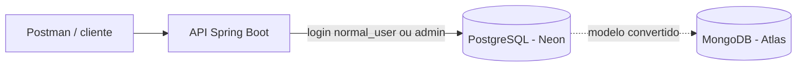

# Jardda League

Banco de dados relacional de futebol (clubes, ligas, estádios, jogadores, técnicos, contratos e partidas), modelado em PostgreSQL, com controle de acesso por roles. O modelo também foi convertido para MongoDB, por pedido do professor da disciplina, apenas como exercício acadêmico.

> **Aviso sobre os dados:** os nomes de **clubes, ligas e estádios** são reais. **Jogadores, técnicos, contratos, salários, partidas e estatísticas são fictícios**, criados apenas para testar o modelo. Nenhum dado deste repositório representa fatos reais sobre pessoas.

## Problema

O projeto nasceu de um trabalho acadêmico de banco de dados. Eu e meu companheiro de equipe reescrevemos o modelo do zero para praticar modelagem relacional de ponta a ponta: integridade referencial, regras de negócio no próprio banco, modelagem temporal (contratos e participação em ligas) e controle de acesso. O objetivo é portfólio na área de Engenharia e Arquitetura de Dados, com custo zero de infraestrutura.

## Dados

O schema `jardda_league` tem 12 tabelas:

- **Localização:** `pais`, `cidade`
- **Entidades:** `clube`, `liga`, `estadio`, `jogador`, `tecnico`
- **Vínculos com período:** `clube_liga`, `clube_jogador`, `clube_tecnico`
- **Jogos:** `partida`, `estatistica_partida`

A carga de teste tem 4 países, 9 cidades, 12 clubes, 4 ligas, 11 estádios, 12 técnicos, 36 jogadores, 12 partidas e 12 registros de estatística.

O diagrama entidade-relacionamento e o minimundo estão em [`docs/`](docs/).

## Arquitetura



- **PostgreSQL (Neon):** banco principal.
- **API Spring Boot:** consome o banco com um dos dois logins (leitura ou escrita).
- **MongoDB (Atlas):** modelo convertido por requisição do professor, apenas para fins de aprendizado acadêmico. Não é usado pela API nem no dia a dia do banco.

## Stack

- **PostgreSQL** no **Neon** (plano gratuito). Migrei do Supabase por limitações do plano gratuito, além de maior grau de aprendizado através do Neon.
- **MongoDB** no **Atlas** (plano gratuito), usado só para a conversão do modelo pedida pelo professor.
- **Spring Boot**, usado como API de consulta e escrita.
- **Postman** para testar as requisições.

## Como rodar

Pré-requisitos: uma conta no Neon, um cliente SQL (ou o editor SQL do próprio Neon) e, para a parte do Mongo, uma conta no Atlas.

1. Crie um projeto no Neon e anote a string de conexão do `neondb_owner`. 
2. Execute o script de criação do schema e das tabelas.
3. Execute o script de carga (`dados_jardda_league.sql`), que cadastra países, cidades, clubes, ligas, estádios, técnicos, jogadores, contratos, partidas e estatísticas. Ele usa ids numéricos fixos, então deve rodar **uma única vez**, em um schema recém-criado. Para repetir, esvazie as tabelas e reinicie as sequências (`TRUNCATE ... RESTART IDENTITY CASCADE`) antes.
4. Crie os dois roles de login, num arquivo **local**, fora do repositório, com senhas fortes:

   ```sql
   CREATE ROLE normal_user WITH LOGIN PASSWORD '<senha-forte>';
   CREATE ROLE admin WITH LOGIN PASSWORD '<senha-forte>';
   ```

5. Execute o script de políticas de acesso como `neondb_owner`.
6. (Opcional, não é necessário para o funcionamento do projeto) Mongo: crie as coleções com os arquivos em /mongodb/collections (pelo `mongosh` ou pelo Compass).

## Políticas de acesso

O dono das tabelas é o `neondb_owner`, usado só para manter a estrutura. A aplicação usa dois logins:

| Role | Permissão |
|------|-----------|
| `normal_user` | Somente leitura (`SELECT`) em todas as tabelas |
| `admin` | Todos os privilégios nas tabelas e nas sequences |

Pontos importantes da implementação:

- É preciso `USAGE` no schema antes de qualquer permissão nas tabelas.
- O `admin` precisa de permissão nas **sequences** dos campos `SERIAL`, senão o `INSERT` falha ao gerar o id.
- `ALTER DEFAULT PRIVILEGES` faz tabelas criadas no futuro herdarem as mesmas permissões.

**Por que dois logins:** a API só precisa receber duas strings de conexão, sem configurar troca de role a cada transação. A decisão considerou 5 alternativas (dois logins, troca de role por transação, variável de sessão, autorização só na aplicação e Neon Data API com JWT) e priorizou simplicidade para quem mantém a API.

### Testes

Testados manualmente, conectado como cada role:

| Role | Operação | Esperado |
|------|----------|----------|
| `normal_user` | `SELECT` em qualquer tabela | Permitido |
| `normal_user` | `INSERT`, `UPDATE`, `DELETE` | Negado (`permission denied`) |
| `admin` | `SELECT` | Permitido |
| `admin` | `INSERT` (com id automático) | Permitido |
| `admin` | `UPDATE`, `DELETE` | Permitido |

## Decisões de modelagem

- **Mandante:** `time_1` é sempre o mandante, e `time_2` o visitante, com `CHECK` para que sejam clubes diferentes.
- **País derivado via cidade:** clube e estádio não têm coluna de país. Ele vem da cidade, para ter uma única fonte de verdade.
- **Contrato com previsão e término:** a previsão (expectativa na assinatura) é separada do término real, que só é preenchido quando acontece. Contrato ativo é o que não tem término.
- **Um contrato ativo por pessoa:** garantido por índice único parcial (`WHERE termino IS NULL`) em jogador e técnico.
- **Clube e liga com período:** `clube_liga` tem entrada e saída, para guardar o histórico.
- **Lesão como booleano:** em vez de um departamento médico, `lesionado` fica no jogador (existem jogadores lesionados sem clube).
- **Estatística em tabela separada:** `estatistica_partida` é 1:1 com `partida`. Escolhi separar para manter `partida` enxuta, aceitando o custo de um `JOIN`.
- **`CHECK` com lista fixa em vez de `ENUM`:** mais simples de alterar.
- **Estádio com clube opcional:** estádios podem ser compartilhados.
- **Datas validadas no banco:** `CHECK` entre 1900-01-01 e a data atual.
- **Salário:** `NUMERIC(10,2)`, valor anual em dólares.

## PostgreSQL x MongoDB

A conversão para MongoDB foi uma requisição do professor da disciplina e foi feita somente para aprendizado acadêmico: ela não tem efeito real sobre o banco nem é usada no dia a dia do projeto, que roda inteiramente em PostgreSQL. As 12 tabelas viraram 6 coleções (`clubes`, `ligas`, `estadios`, `tecnicos`, `jogadores`, `partidas`). A descrição campo a campo está no arquivo `modelo_mongodb.md`.

**O que foi embutido**
- País e cidade viram subdocumentos.
- Contratos ficam como um array dentro de jogador e técnico.
- O histórico de ligas fica como um array dentro do clube.
- A estatística vira um subdocumento da partida (era 1:1).

**O que ficou como referência:** onde um documento aponta para outro (por exemplo, partida para clube), guardo o id e uma cópia do nome. Isso evita junções nas leituras comuns, ao custo de a cópia poder ficar desatualizada.

**O que o MongoDB não garante e o PostgreSQL garantia**
- Chaves estrangeiras (integridade entre coleções).
- `CHECK` de intervalo de datas, `termino > inicio` e `time_1 <> time_2`.
- Um único contrato ativo por pessoa (o índice parcial não se aplica a arrays embutidos).

Essas regras passam a ser responsabilidade da aplicação.

**Minha avaliação:** o domínio de futebol é fortemente relacional (vínculos N:N com período, partidas que referenciam dois clubes, classificação calculada por agregação). Por isso, o PostgreSQL é a escolha principal e a única base realmente usada. A conversão serviu só para comparar, na prática acadêmica, as duas formas de modelar. Não há carga real no Mongo: apenas as coleções e, opcionalmente, dados de exemplo fictícios. 

## Aprendizados

- **Erros recorrentes de DDL:** vírgulas faltando, `FOREIGN KEY` sem parênteses, `CHECK` sem o nome da coluna, datas sem aspas. O hábito que ajuda é rodar o script do zero num schema de teste a cada mudança.
- **Transações:** depois de um erro dentro de uma transação, o Postgres ignora tudo até o `ROLLBACK` (erro 25P02).
- **Cargas e ids:** a sequência do `SERIAL` não volta atrás quando uma transação falha, então ids digitados à mão na carga só funcionam em um schema recém-criado. Para repetir uma carga, é preciso esvaziar as tabelas e reiniciar as sequências.
- **Permissões em camadas:** `USAGE` no schema, permissão na tabela e permissão na sequence são coisas distintas.
- **Escopo:** cortar a frente de mídia e congelar o schema foi o que permitiu publicar.
- **Modelagem em documentos:** escolher o que embutir e o que referenciar é uma decisão sobre como os dados serão lidos.

## Uso de IA

Usei o Claude (Anthropic) e o ChatGPT(OpenIA) como ferramentas de **consulta e de melhoria da arquitetura**: revisão do schema, discussão das alternativas de políticas de acesso e dos trade-offs entre PostgreSQL e MongoDB, montagem deste README e explicação de erros. A IA também gerou os dados utilizados no banco, devido ao tamanho do escopo do banco, além de auxiliar na construção dos scripts do MongoDB. As decisões de escopo e de modelagem, a execução dos scripts e os testes foram feitos pela equipe.
